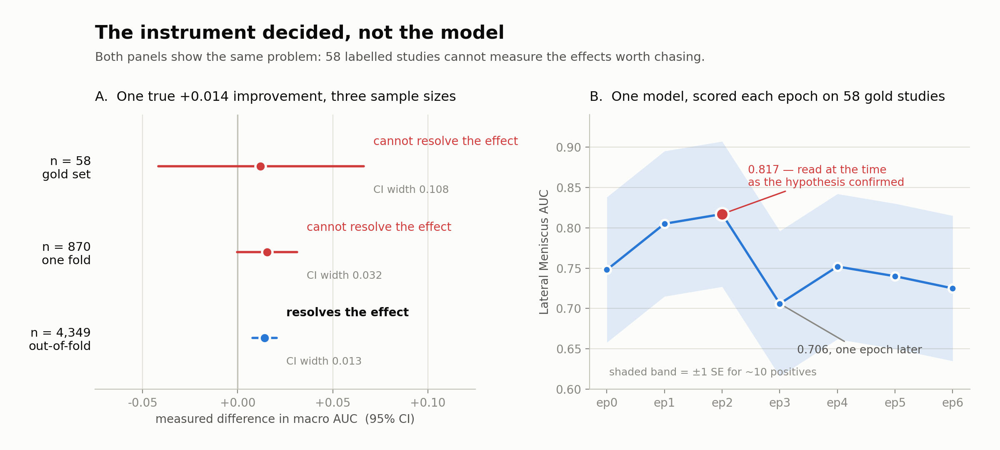

# RSNA Knee Abnormality Detection

Eleven changes were tried against a 12-finding knee MRI classifier. Ten were
null. The eleventh — fusing public report labels with 5-fold ensembling —
moved the public leaderboard from 0.891 to 0.903. The interesting part isn't
the score; it's *why* ten reasonable ideas measured as doing nothing, and
whether that's because they don't help or because the only ground truth
available (58 labeled studies, out of 4,407) can't tell the difference.

<picture>
  <source media="(prefers-color-scheme: dark)" srcset="results/measurement_dark.png">
  
</picture>

**A** (simulated): a known, synthetic +0.014 macro-AUC effect, measured with
this project's own paired-bootstrap code (`src/stats.py`) at three sample
sizes. Unresolvable at 58, unresolvable at 870, clear at 4,349 — the same
true effect, three different verdicts, depending only on which instrument
measured it. **B** (real, measured): Lateral Meniscus AUC per epoch from the
actual 5-plane training run. The 0.817 at epoch 2 was briefly read as
confirming a hypothesis about PD/T1 sequences; the full curve one epoch
later shows it was noise (~10 positives in 58 studies, SE ≈ 0.09). Panel A
is a controlled demonstration; panel B is what the same failure mode looked
like in practice.

This measurement finding is also published as a standalone, live-running
notebook: **[kaggle.com/code/abhiroopsarkar/the-instrument-decided-not-the-model](https://www.kaggle.com/code/abhiroopsarkar/the-instrument-decided-not-the-model)**.
The report-label dataset this project generated is published separately:
**[kaggle.com/datasets/abhiroopsarkar/rsna-knee-gemini-report-labels](https://www.kaggle.com/datasets/abhiroopsarkar/rsna-knee-gemini-report-labels)**.

## Problem and constraints

- 4,407 training studies, 24,371 series, 819,640 DICOM files (569 GB).
- Expert ("gold") labels exist for only **58** of those studies. The other
  4,349 have a free-text radiology report but no structured label — in any
  language (Greek, Turkish, English, and others).
- Reports are **not available at test time**; the hidden ~1,300-study test
  set has to be predicted from images alone.
- Hardware: a single Kaggle T4, 30 GPU-hours/week.
- Metric: macro-averaged AUC ROC over the 12 findings `ACL, MCL, Medial
  Meniscus, Lateral Meniscus, Medial OA, Lateral OA, PF OA, Effusion,
  Synovitis, Baker's, Contusion, Fracture`.

The central design problem follows directly from the second constraint: the
only ground truth available for validating any modeling decision covers 58
studies, and macro AUC on 58 studies has a standard error around 0.03 — larger
than most of the effects worth chasing. Most of the engineering effort in
this project went into working around that, not around the model.

## Measurement first

Before trusting any number in this repo, read **[`results/measurement.md`](results/measurement.md)**.
Short version:

- A 3-plane vs 5-plane model pair, same folds, same labels, differed by
  **0.0177** on gold-58 and **0.0001** on out-of-fold (OOF) evaluation over
  the full 4,349 report-labeled studies. Same models — the instrument
  decided which answer looked true.
- The same checkpoint scored 0.877 and 0.873 on two evaluations that
  differed only in random slice sampling — about 0.004 of pure noise
  before any model change is considered.
- A synthetic injected +0.014 macro AUC improvement is **not resolvable**
  by paired bootstrap at n=58 or n=870, and clearly resolvable at n=4,349
  (`src/stats.py`, runnable standalone — `python src/stats.py`).

Given this, every comparison in this project uses **paired bootstrap**
(`src/stats.py::paired_bootstrap`) rather than point-estimate deltas, and the
one change that was actually kept (fused public labels + 5-fold ensembling)
was validated on OOF and the leaderboard, not on gold-58 alone.

## Data

Competition data is **not redistributed in this repo** (Kaggle's rules don't
permit it) — `train.csv`, the generated label files, and the preprocessed
image shards are all gitignored. To reproduce:

1. Download `train.csv` and the DICOM series from the
   [RSNA Knee Abnormality Detection competition page](https://www.kaggle.com/competitions/rsna-knee-abnormality-detection)
   (requires accepting the competition rules).
2. Run `src/01_preprocess.py` to build the 3 fluid-sensitive-plane shards,
   and `notebooks/02_preprocess_nonFS.ipynb` to build the 2 non-FS-plane
   shards (sagittal + coronal PD/T1) used in the 5-plane ablation. If the
   shards were built in batches, `notebooks/03_consolidate_shards.ipynb`
   merges them into one dataset.
3. `python src/02_label_reports.py` (needs `GEMINI_API_KEY` set in your
   environment) to regenerate the report labels, or substitute one of the
   public label tables credited below.
4. `python src/04_train_5fold.py` to train.

Model checkpoints (`*.pt`) and shard files (`*.npz`) are also excluded —
regenerate them from the steps above rather than expecting them in git.

## Pipeline

| Stage | Script | What it does |
|---|---|---|
| 1 | [`src/01_preprocess.py`](src/01_preprocess.py) | DICOM → fixed-size uint8 shards, 3 fluid-sensitive planes, K=24 slices/plane, S=192px |
| 2 | [`src/02_label_reports.py`](src/02_label_reports.py) | Batched Gemini labeling of the 4,349 report-only studies (12 findings, structured JSON output, multi-model free-tier rate scheduler) |
| 3 | [`src/03_label_eval.py`](src/03_label_eval.py) | Score any label table against gold-58 |
| 4 | [`src/04_train_5fold.py`](src/04_train_5fold.py) | The kept config: EfficientNet-B0, 3-plane, 5-fold, fused public labels |
| 5 | [`src/05_probe.py`](src/05_probe.py) | Single-fold probe harness (P1/P2/P3) against a pre-registered decision threshold |
| 6 | [`src/06_inference.py`](src/06_inference.py) | 5-fold ensemble + TTA submission |
| 7 | [`src/07_prompt_experiment.py`](src/07_prompt_experiment.py) | Evidence script: single-label prompt rewrite + replication test on the 4 weakest labels (results in `results/measurement.md`) |
| 8 | [`src/08_synovitis_diagnostic.py`](src/08_synovitis_diagnostic.py) | Evidence script: confirms Synovitis misses never mention "synovi-" in the source report (label noise, not a prompt gap) |
| — | [`src/stats.py`](src/stats.py) | Paired bootstrap, macro AUC, per-label AUC, positive counts, prediction correlation |

Raw Kaggle notebooks (including superseded/ablation variants: baseline,
5-plane, b2-config, b3-config) are kept under `notebooks/` for reproducibility.

**Two different dependency sets.** `requirements.txt` covers what runs
locally — labeling (2, 7, 8), label evaluation (3), stats, and the figure.
Preprocessing and training (1, 4, 5, 6) ran on Kaggle's own GPU environment
and need `torch`, `timm`, `opencv-python`, `pydicom` and `tqdm`, none of
which this repo pip-installs locally — install them yourself if reproducing
those stages outside Kaggle. `requirements-dev.txt` is one-time tooling
(`kaggle`, `nbconvert`) used only to pull and convert the notebooks into
this repo; not needed to run the pipeline.

### Training configuration (held constant unless an experiment says otherwise)

```
backbone        efficientnet_b0 (timm, pretrained, in_chans=1)
head            per-plane attention pooling -> concat(P*D + P) -> Linear(12)
slices used     KU = 16 of 24 (random subset in training, even grid at eval)
batch size      4
optimiser       AdamW, lr 3e-4, weight decay 1e-2
schedule        OneCycleLR, pct_start 0.1
precision       AMP fp16
augmentation    intensity jitter + random roll.  NO FLIPS - medial/lateral
                must stay fixed, flipping would swap the anatomy the labels name
loss            BCE on soft labels
epochs          7
split           5-fold KFold(shuffle=True, random_state=0) over the 4,349
                report-only studies; the 58 gold studies are NEVER trained on
```

### Reproducibility

| | |
|---|---|
| Hardware | single Kaggle T4, 30 GPU-hours/week budget |
| Seeds | `random_state=0` for the 5-fold split; `seed=0` default in every `src/stats.py` bootstrap call |
| Package versions | pinned per-notebook in `notebooks/*.ipynb` kernel metadata (each ran in its own Kaggle environment); `requirements.txt` covers the local labeling pipeline (`pandas`, `google-genai`) |
| Epoch wall-clock (T4) | b0 3-plane 282s · b0 KU=24 415s · b2 465s · b3 (BS=3) 550s · b0 5-plane 528s · per-finding pooling 318s · 2.5D 276s |

One command per result, so any row in `results/ablations.md` or
`results/measurement.md` can be checked rather than taken on faith:

| Result | Command |
|---|---|
| Label quality (own labels vs gold-58) | `python src/03_label_eval.py` |
| Prompt-rewrite experiment + replication | `python src/07_prompt_experiment.py` |
| Synovitis label-noise diagnostic | `python src/08_synovitis_diagnostic.py` |
| Probe harness (table 6, rows 9–11) | `python src/05_probe.py` with `PROBE = 'P1'` set at the top of the file (`'P2'`, `'P3'` for the others — not a CLI flag) |
| Paired-bootstrap self-test / figure panel A data | `python src/stats.py` |
| Figure (both themes) | `python src/make_figure.py` |

## Labeling the report-only studies

4,349 of 4,407 studies have no structured label, only a free-text report.
These were labeled with Gemini (`src/02_label_reports.py`), using a single
prompt that scores all 12 findings per report with structured JSON output,
batched 10 reports/call, scheduled across multiple free-tier models
(`gemini-3.1-flash-lite`, `gemini-3.5-flash-lite`, `gemini-3.8-flash`,
`gemini-3-flash-preview`, `gemini-3.7-flash`) each paced to its own
RPM/RPD limit to avoid wasting quota on throttled retries.

Resulting macro AUC against gold-58: **0.866**. Public label tables from
other competitors scored 0.835–0.893 (`results/measurement.md`); the
strongest, `v4_blend` (0.893), was what the final model trained on.

A targeted attempt to improve the four weakest own-labels (Lateral OA,
PF OA, Effusion, Contusion) with single-label prompts and graded confidence
anchors made three of four *worse* — one by 0.095, too large to be noise —
and the one apparent gain (+0.029 on Lateral OA) failed to replicate across
reruns. Full writeup in `results/measurement.md`. The original combined
prompt remained in production.

## Ablations: what worked and why, stated plainly

Full table and all eleven experiments: **[`results/ablations.md`](results/ablations.md)**.

**What worked:** fusing public report labels (`v4_blend`, 0.893 label-quality
AUC) with 5-fold ensembling moved the public leaderboard from **0.891 to
0.903**. This is the only change in the project validated end-to-end,
including on the hidden test set.

**What didn't move anything measurable**, each checked against an instrument
appropriate to the claimed effect size:

- Backbone capacity: b0 → b2 → b3 (gold-58: null, null)
- More slices + max-pool head (gold-58: null)
- 5 planes instead of 3 (gold-58: null; **confirmed null on OOF too** — the
  one ablation checked on both a weak and a strong instrument)
- 14 vs 7 epochs (val-870: peaked at epoch 5, then 8 epochs of decline —
  the apparent late-epoch improvement in 7-epoch runs is a OneCycle LR
  schedule artefact, not continued learning)
- Per-finding attention pooling, 2.5D slicing, 4-table label mean
  (val-870, pre-registered threshold 0.870: all three missed it; probe
  spread across variants was 0.0075 — one-fold noise)
- 3- and 4-model ensembling (gold-58 + paired bootstrap: +0.0092 and
  +0.0005 respectively, both CIs crossing zero — inconclusive and null)

The ensembling null has a direct mechanistic explanation: every pair of the
four trained backbones correlated at 0.88–0.91 on their predictions. Models
that agree that strongly have little independent error left for averaging
to remove.

**Important nuance — "null" is not "proven to not help."** Every negative
result above was measured on an instrument whose standard error is
comparable to or larger than the effect being tested. A result landing
inside the noise band means the harness couldn't resolve it, not that the
true effect is zero. See the Limitations section below and
`results/measurement.md` for the quantitative version of this caveat.

## Leaderboard context

| Run | Config | Labels | Public LB |
|---|---|---|---|
| 1 | b0, single 85/15 split, 3-plane | own Gemini (0.866) | 0.891 |
| 2 | b2, single 85/15 split, 3-plane | own Gemini (0.866) | 0.890 |
| 3 | b0, **5-fold**, 3-plane | **v4_blend (0.893)** | **0.903** |

The published top-leaderboard 0.958 blend is inference-only: it trains
nothing and loads three public checkpoint datasets (nartaa's CoAtNet-2
trained with external OAI data, heliosli's ConvNeXt-small R6 with flip TTA,
and goodpjw2008's 2.5D ConvNeXt reader at 1/10 weight). That notebook had
284 copies; its rank (195/6,077) means a large share of the leaderboard
above this project is running shared weights, not models trained from the
competition data.

The relevant comparison for a competition-data-only model is goodpjw2008's
reader at **0.929**, trained on 5 folds with soft labels from four public
tables, gold-58 held out. This project reached 0.903 under the same
constraints. Final standing: ~4,000 of ~6,000.

## Credits

Public report-label tables used or evaluated: **stevenleehans**, **Pilkwang
Kim**, **lixin73**. Leaderboard context from the public write-ups by
**goodpjw2008**, **heliosli**, **nartaa (Danial Zakaria)** and
**Yash Bishnoi**.

## Limitations

- **The 0.891 → 0.903 jump confounds two changes, and the isolating
  experiment was never run.** Fused labels and 5-fold ensembling were both
  introduced in the same run. The missing experiment is specific: a
  single-split run on b0 with `v4_blend` labels (holding fold-ensembling
  fixed at "off," the same config as leaderboard run 1 but with the better
  labels) — roughly 1 GPU-hour on the available T4. It was not run before
  the competition deadline, so the individual contribution of better labels
  vs. ensembling is not separated in this repo.
- **No physical-space resampling.** Every knee is padded and resized to
  192px regardless of field of view, so mm-per-pixel varies across studies.
  The 0.929 reference reader resamples to 0.4mm/px; this was never tried
  here. See Future Work.
- **Single architecture family throughout** — EfficientNet + attention
  pooling. No transformer over slices, no cross-series attention.
- **192px / 24 stored slices were fixed after the first preprocessing pass**
  and never revisited at higher resolution, for lack of GPU-hours.
- **Probes were single-fold** (standard error ≈0.01), so a true effect
  around +0.005 would likely have gone undetected by the P1/P2/P3 harness.
  The 0.870 decision threshold was chosen to control false positives, at
  the direct cost of statistical power to detect real small gains. A
  reviewer should not read the probe nulls as proof those ideas don't help
  — only that this harness, at this sample size, couldn't tell.
- **Lateral Meniscus remains the clearest unresolved gap**: text-label
  (teacher) AUC 0.881 vs image-model AUC 0.780 against gold-58. Unlike
  Synovitis (confirmed label noise — see `results/measurement.md`), this
  gap looks real and image-side. See Future Work.

## Future work

Concrete, specific things the 0.929 reference reader does that this project
doesn't, in rough order of expected payoff:

- **Physical-space resampling.** Resample each series to a fixed mm/px
  (e.g. 0.4mm/px, matching the 0.929 reader) instead of padding/resizing
  every knee to 192px regardless of field of view. Field-of-view variance
  across 4,407 studies is untested as a source of error here.
- **Sagittal-only shards at higher resolution for Lateral Meniscus
  specifically.** The gap (teacher 0.881 vs model 0.780) is plausibly a
  resolution problem on a small structure, and menisci are normally read on
  the sagittal plane. Building S=320 sagittal-only shards isolates both the
  right plane and more pixels, as a targeted fix rather than a global
  resolution increase.
- **A transformer over all series/windows** instead of per-plane attention
  pooling — the current head independently pools each plane and
  concatenates; it never attends across planes or across the full study at
  once.
- **Fuse four label tables instead of one.** `results/measurement.md` shows
  naive mean-of-top-n fusion, tested against gold-58, never beat the single
  best table (`v4_blend`, 0.893) — but gold-58 is exactly the instrument
  `measurement.md` shows can't resolve a +0.01-scale effect. The 0.929
  reader fuses four tables; worth re-testing fusion against OOF or the
  leaderboard, not gold-58 alone.
